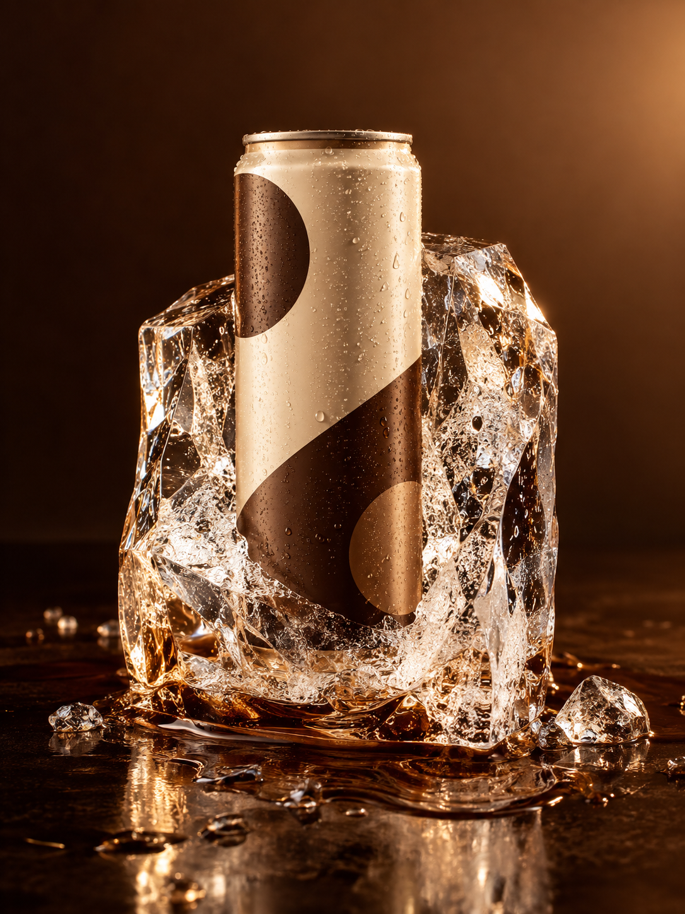
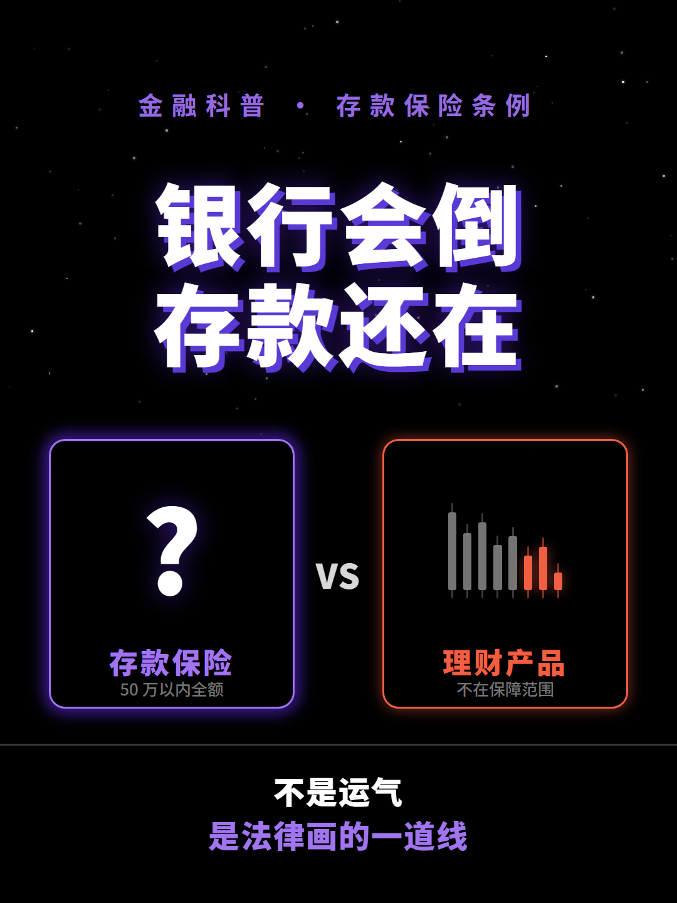

# AI 产品与内容工作流 · 项目展示

围绕两个个人项目整理的评估材料：**造物 AIGC 视觉工作台**与**科普视频工作流**。

这里展示需求拆解、工具选型、AI 协作、实际产物和验证边界。项目属于个人实践，不以企业客户交付、规模化运营或全部自主研发作表述。

## 从这里看起

| 内容 | 入口 |
|---|---|
| 18 项相关 Skill 的名称、用途和项目关系 | [Skill 清单](docs/skills.md) |
| 造物工作台：目标、流程、本人参与与当前边界 | [项目说明](projects/zaowu.md) |
| 科普视频：制作链路、真实样片与分镜片段 | [项目说明](projects/explainer.md) |
| 图片提示词 Skill：第三方文档与参考资料 | [image / SKILL.md](skills/image/SKILL.md) |
| 科普 Skill：本地使用版本的入口片段 | [anything2explainer 片段](skill-excerpts/anything2explainer.md) |
| 第三方来源与许可 | [来源说明](THIRD_PARTY_NOTICES.md) |
| 本次发布核验范围 | [发布检查](docs/release-check.md) |

## 真实产物预览

两张造物图库样图：AI 生成的虚构创意示例，不是客户交付或上传商品的保真结果。

  
  

科普项目《为什么银行倒闭了，你的存款还能拿回来？》的既有封面及开头 30 秒样片：

[查看或下载真实 30 秒样片](assets/explainer-preview-30s.mp4) · [查看分镜片段](examples/storyboard-excerpt.md)

样片与封面作为历史制作成果展示，本仓库不更新其中的时效性事实。

## Skill 的使用状态

- `anything2explainer` 是本次科普项目说明的核心工具，配有既有产物。
- 其他条目按用途相关性列入；本地存在 Skill 文档，不等于已接入两个项目或已完成所有外部接口验证。
- Remotion 的多个条目属于同一技术体系；生成式视频、配音和转写服务属于不同工具选项，不是一条全部接通的产线。
- `skills/image` 是第三方资料副本，不是本人原创模型、引擎或自研 Skill。其说明与模型参数代表收录版本，使用前需核对相应平台最新文档。

## 分享范围

本仓库为独立整理的公开展示版本。包含项目说明、样例、工具目录与明确注明来源的资料；不包含两个项目的完整应用源码、私有素材、账号配置和原始 Git 历史。

对实际实现可进一步结合运行演示与指定模块说明。完整工程接入、维护支持及商业使用范围需另外明确；第三方内容按其原许可证处理。

整理日期：2026-10-19。
